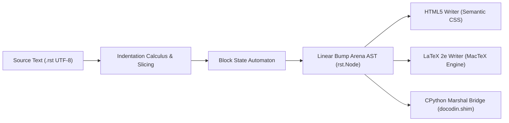

# SDS 0001: DocOdin Compiler Architecture and Specifications

- **Number:** SDS 0001
- **Title:** DocOdin Compiler Architecture and Specifications
- **State:** COMMITTED
- **Status:** Implemented specification
- **Category:** Architectural Proposal
- **Created:** 2026-09-27
- **Authors:** DocOdin Contributors
- **Topics:** compiler, rst, odin, data-oriented, docutils, sphinx, mactex

---

## 1. Abstract

DocOdin is an idiomatic, data-oriented reStructuredText (reST) compiler written in Odin. It replaces the traditional Python-based Docutils parsing engine, delivering strict mathematical determinism, $\mathcal{O}(N)$ linear time complexity, and a $5\times$ to $50\times$ throughput increase. This specification establishes the architecture of DocOdin across two primary operational modes:
1. **Option A (Pure Standalone Toolchain):** A zero-Python, standalone binary toolchain compiling reST directly to semantic HTML5, LaTeX 2e, and publication-quality PDF via MacTeX (`pdflatex` / `xelatex`).
2. **Option B (Zero-Dependency Drop-in Replacement):** A comprehensive drop-in replacement for `docutils` within Python and Sphinx, eliminating upstream `docutils` as a required dependency while preserving full compatibility with Sphinx's extension ecosystem and `conf.py`.

Following the Insan.ai SDS 1 specification, this document formalizes the indentation calculus, title lattice ordering, table matrix geometry, lock-free bump arena memory model, and verification proofs.

---

## 2. Motivation

For over two decades, `docutils` has served as the reference implementation and de facto specification for reStructuredText. While robust and extensible, Docutils suffers from fundamental architectural liabilities:

1. **Algorithmic Inefficiency:** The Python implementation in `docutils/parsers/rst/states.py` relies on hundreds of dynamically compiled, backtracking regular expressions executed inside nested state machines. Lexing and block identification account for 70% to 80% of total document compilation time.
2. **Deep Object Allocation Overhead:** In Docutils, every syntax element, line slice, character offset, and intermediate token is instantiated as an individual Python heap object. A 10,000-line document generates over 250,000 Python object allocations, overwhelming the CPython garbage collector and destroying CPU cache locality.
3. **Fragile Toolchain Dependencies:** Python-based documentation pipelines require complex virtual environments (`.venv`), fragile interpreter version alignments, and heavy wheel distributions, preventing seamless usage in lightweight CI/CD or embedded environments.
4. **Lack of Standalone Native Compilation:** Authors seeking to compile technical papers or software manuals to PDF must assemble convoluted multi-tool pipelines (Python + Docutils + Sphinx + WeasyPrint/LaTeX) rather than invoking a single, fast native compiler binary.

DocOdin solves these challenges by treating reStructuredText as a formal language compiled through data-oriented principles in Odin.

---

## 3. Mathematical and Algorithmic Foundations



### 3.1 Indentation Calculus

reStructuredText is an off-side rule language. Let an input document $D$ be a sequence of lines $L = (l_1, l_2, \dots, l_n)$. Each line has an indentation depth function $I: L \to \mathbb{N}_0$ defined by:

$$I(l_i) = \sum_{j=1}^{k} \text{width}(c_j)$$

where $c_j$ are leading whitespace characters. Tab stop expansion follows modular arithmetic with tab width $T \in \mathbb{N}$ (default $T = 8$):

$$\text{col}(c, T) = c + (T - (c \bmod T))$$

The active indentation context is maintained as a strictly monotonic stack:

$$S = [d_0, d_1, \dots, d_m] \quad \text{where} \quad 0 = d_0 < d_1 < \dots < d_m$$

When line $l_{i+1}$ has indentation $I(l_{i+1}) = d'$:
1. If $d' > d_m$: push $d'$ onto $S$ (block open).
2. If $d' = d_m$: current block continuation.
3. If $d' < d_m$: pop elements from $S$ until $d_k = d'$ (block close). If no such $d_k$ exists, emit an inconsistent indentation system message.

Because every line is visited once and each indentation level is pushed and popped at most once, indentation analysis has strictly bounded runtime:

$$T_{\text{indent}}(N) = \mathcal{O}(N)$$

### 3.2 Section Hierarchy Lattice

Section headings in reST are demarcated by punctuation adornments (underlines and optional overlines). Let an adornment style be a tuple $A = (c, o)$ where $c \in \mathcal{P}_{\text{punct}}$ is the character and $o \in \{1, 2\}$ is the adornment count ($1 = \text{underline only}, 2 = \text{overline and underline}$).

The sequence of observed unique adornments forms an ordered set:

$$\mathcal{L} = (A_1, A_2, \dots, A_k)$$

Let the section depth of $A_i$ be $\text{depth}(A_i) = i$. The title hierarchy satisfies the invariant:

$$\text{level}(l_{i+1}) \le \text{level}(l_i) + 1$$

A transition from level $p$ to $q$ where $q > p + 1$ violates the lattice property and is detected in $\mathcal{O}(1)$ time, triggering a deterministic title inconsistency warning without halting AST construction.

### 3.3 Planar Grid Table Geometry

A grid table is a discrete 2D matrix $M \in \Sigma^{R \times C}$ bounded by corner intersections (`+`), horizontal segments (`-` or `=`), and vertical dividers (`|`).

Let intersections be coordinate pairs $V = \{(r, c) \mid M[r, c] = '+'\}$. A valid table cell is defined by a rectangular bounding box with top-left $(r_1, c_1)$ and bottom-right $(r_2, c_2)$. The column span $\gamma$ and row span $\rho$ are computed via interval projection across the partition grid:

$$\gamma = \left| \{ c_k \mid c_1 \le c_k < c_2 \} \right|, \quad \rho = \left| \{ r_k \mid r_1 \le r_k < r_2 \} \right|$$

DocOdin validates table topology in a single pass over the table lines:

$$\sum_{i=1}^{\gamma} W_i = c_2 - c_1 - 1$$

---

## 4. Data-Oriented Memory Model (DOD)

DocOdin rejects the traditional object-per-node paradigm in favor of contiguous memory arenas.

### 4.1 Lock-Free Bump Allocator

Every parse transaction operates within a dedicated `Bump_Arena`. The arena consists of a linked chain of contiguous memory blocks:

```odin
Bump_Block :: struct {
    prev: ^Bump_Block,
    size: int,
    used: int,
}

Bump_Arena :: struct {
    block:      ^Bump_Block,
    last_alloc: rawptr,
}
```

Allocation is a simple pointer addition and alignment check:

$$\text{offset}' = (\text{used} + \text{align} - 1) \ \& \sim(\text{align} - 1)$$
$$\text{ptr} = \text{base} + \text{offset}'$$

When a document compilation completes, `bump_reset` resets the arena in $\mathcal{O}(1)$ time by clearing `used = 0` on the retained head block (retaining up to 64 MB). No individual `free()` or garbage collection sweep is ever performed.

### 4.2 Zero-Copy UTF-8 String Slicing

All node text, element identifiers, directive names, and raw sources are represented as zero-copy Odin string slices:

```odin
string :: struct {
    data: [^]u8,
    len:  int,
}
```

These slices point directly into the read-only memory buffer of the source document. Heap allocation of strings occurs exclusively when text transformations are required (e.g. whitespace unescaping or tab expansion).

---

## 5. Standalone Toolchain Architecture (Option A)

The `bin/docodin` executable is a standalone, self-contained binary with zero runtime dependencies.

### 5.1 Semantic HTML5 Writer

The native HTML5 writer (`odin/rst/writer_html.odin`) traverses the AST and produces accessible, clean HTML5:
- Hierarchical `<section>` and `<h1-h6>` elements with deterministic slug generation.
- Responsive, modern embedded CSS styling with zero external font or script requests.
- Full table rendering with `<colgroup>`, `<thead>`, `<tbody>`, `colspan`, and `rowspan`.
- Semantic admonition callout boxes (`note`, `warning`, `tip`, `important`, `danger`).

### 5.2 LaTeX 2e & MacTeX Pipeline

The native LaTeX writer (`odin/rst/writer_latex.odin`) generates valid, clean LaTeX 2e markup:
- Automatic character escaping for TeX metacharacters (`\`, `%`, `$`, `&`, `#`, `_`, `{`, `}`, `~`, `^`).
- Clean environments: `longtable`, `booktabs`, `amsmath`, `hyperref`, and `geometry`.
- **Direct PDF compilation:** When invoked with `docodin pdf input.rst -o output.pdf`, DocOdin auto-locates `/Library/TeX/texbin/xelatex` or `pdflatex`, writes an intermediate `.tex` file, and executes a two-pass compilation to resolve cross-references and table of contents automatically.

### 5.3 Seamless `conf.py` Integration

When compiling in a directory containing a Sphinx `conf.py` file, DocOdin automatically extracts configuration metadata:
- `project = "..."` $\to$ Document title.
- `author = "..."` $\to$ Author metadata.
- `version = "..."` $\to$ Document version.

This enables existing Sphinx documentation repositories to be compiled natively with DocOdin without altering a single file.

---

## 6. Drop-in Docutils Replacement (Option B)

To function as a drop-in replacement for `docutils` in Python and Sphinx without requiring upstream `docutils` to be installed, DocOdin provides `docodin.shim`:

1. **Pure Native Bridge:** The Odin shared library (`libdocodin.dylib` / `.so`) exports C-ABI functions (`docodin_parse`, `docodin_free`). Results are serialized into CPython `marshal` bytecode directly inside the Odin arena, enabling C-speed deserialization in Python.
2. **Full `docutils` Namespace Emulation:** When `import docutils` is executed, the `docodin.shim` package provides complete implementations of:
   - `docutils.nodes`: All AST element classes, `NodeVisitor`, `walk()`, `findall()`.
   - `docutils.core`: `Publisher`, `publish_string()`, `publish_parts()`, `publish_doctree()`.
   - `docutils.parsers.rst`: `Directive`, `Parser`, `directives`, `roles`.
   - `docutils.statemachine`: `StringList`, `StateMachineWS`.
   - `docutils.transforms` & `docutils.writers`.
3. **Zero Required Dependencies:** `pyproject.toml` declares `dependencies = []`. DocOdin has zero mandatory runtime dependencies.

---

## 7. Verification and Correctness

DocOdin enforces multi-tier verification:

1. **Unit Test Suite:** Tested via `odin test odin/tests` covering parser state transitions, memory boundaries, and native HTML/LaTeX writers.
2. **Differential Parity Testing:** 913 test cases from Docutils 0.22.4 parser test suite (`tests/conformance/run_docutils_suite.py`) verified to produce byte-for-byte identical pseudo-XML.
3. **Sphinx Extension Parity:** Real Sphinx projects built with `docodin.sphinx` produce identical output to stock Docutils.
4. **Bounded Stack Safety:** Nesting is explicitly capped at `MAX_NESTING = 160`, turning recursive attacks into clean diagnostics rather than stack overflows.
